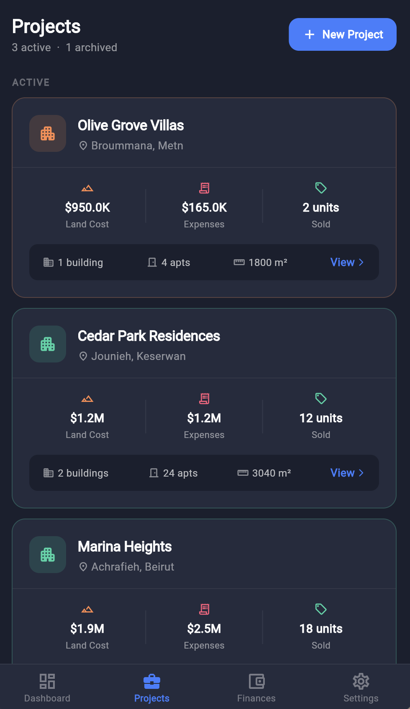
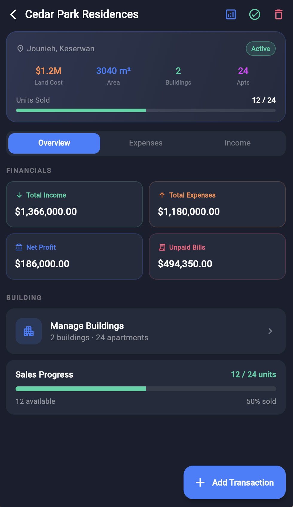
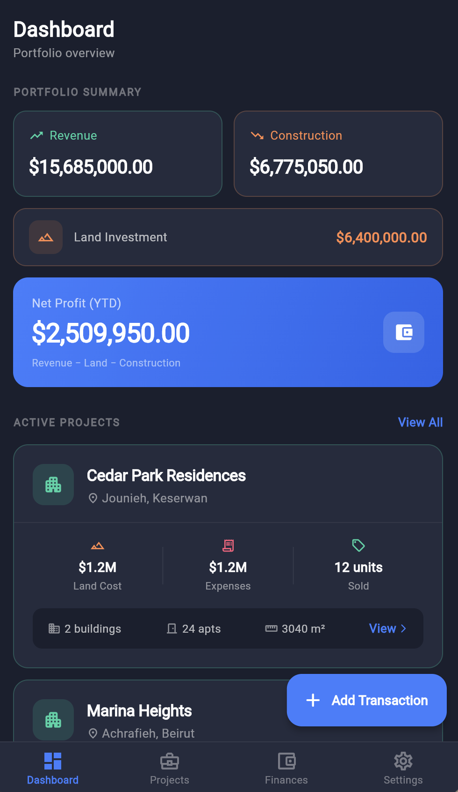
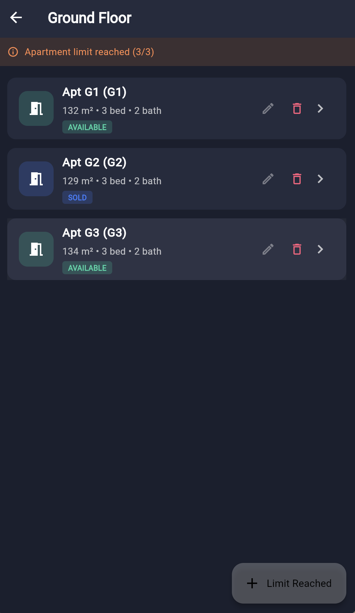
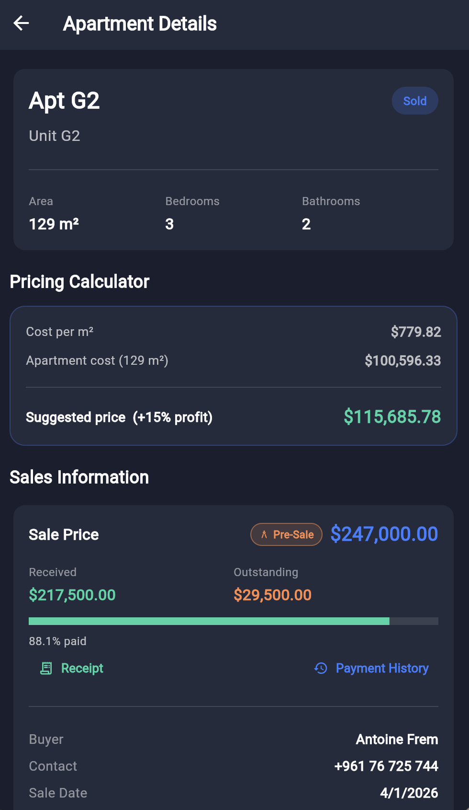
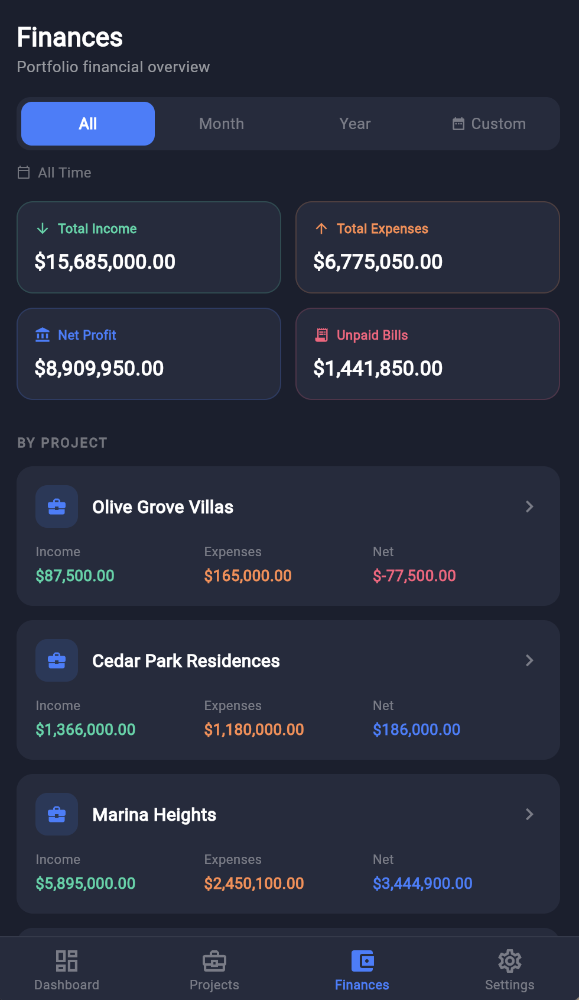

# FAME Construction & Real Estate Management 🏢

A freelance cross-platform mobile application designed to assist project managers and clients in tracking building costs, floor sales, and financial ledgers. 

### 📸 Screenshots

**Projects & Dashboard**

**Apartments & Details**

**Financial Overview**

### 🛠️ Tech Stack
* **Front-End / Mobile Client:** Flutter
* **Back-End / API:** Node.js

### 🚀 Key Features
* **Financial Ledgers:** Tracks building costs, client payments, and overall project finances.
* **Pipeline Tracking:** Automates property income and commission calculations while tracking each deal through the sales pipeline.
* **Cross-Platform:** Client-delivered mobile application built for seamless use across devices.
